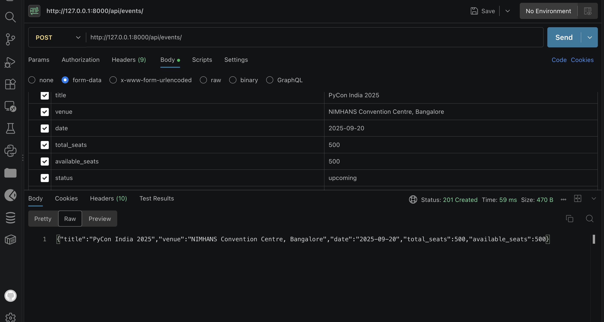
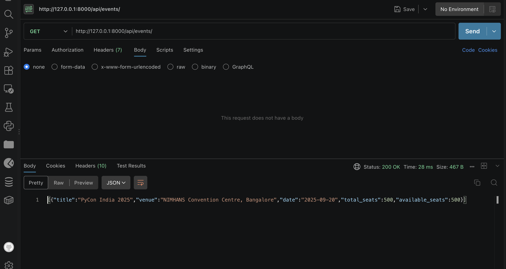
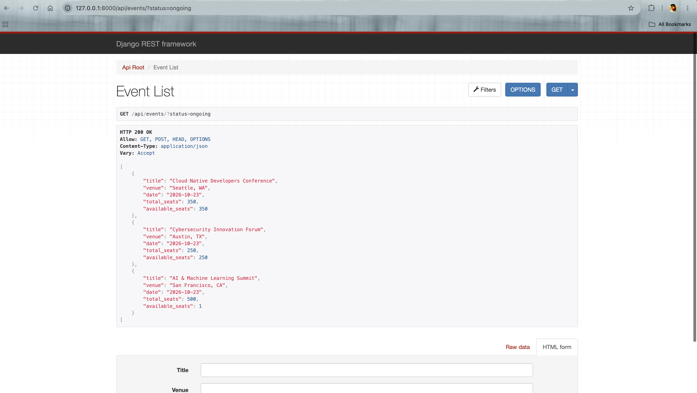
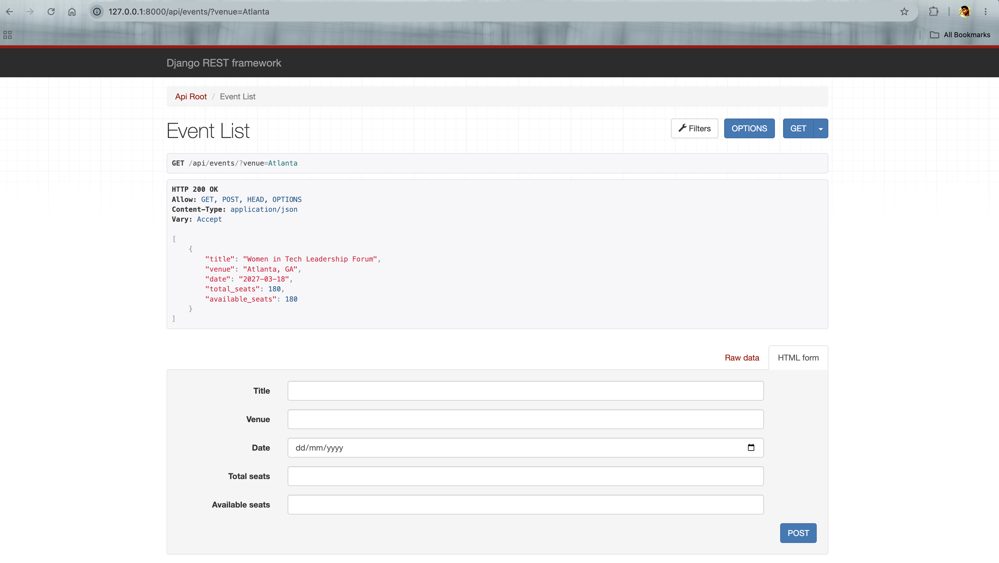
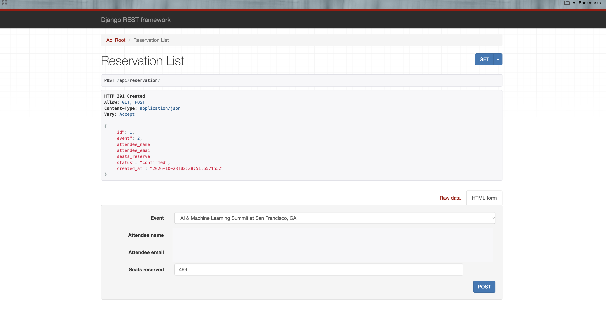
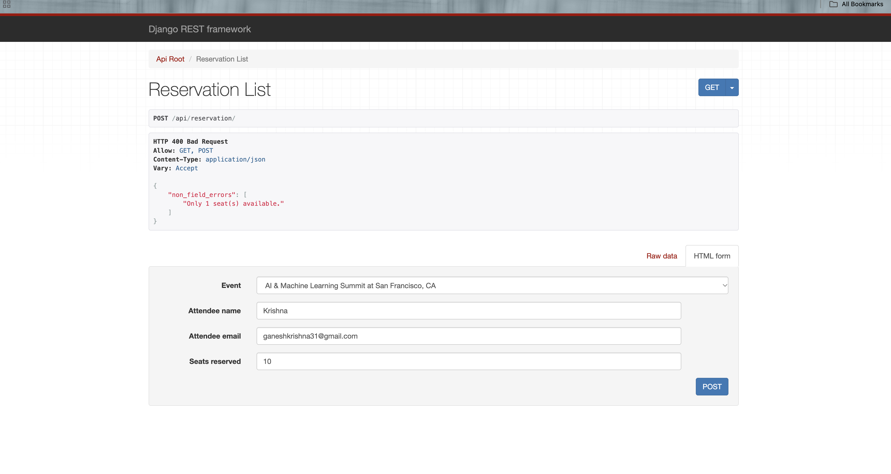
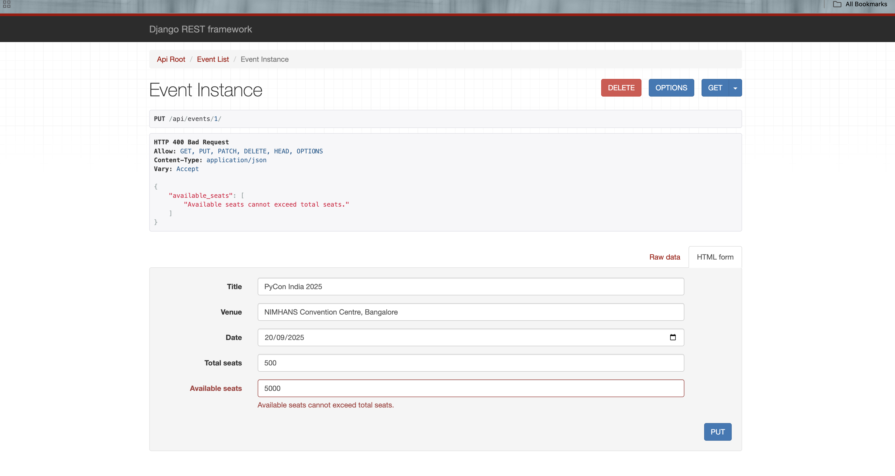
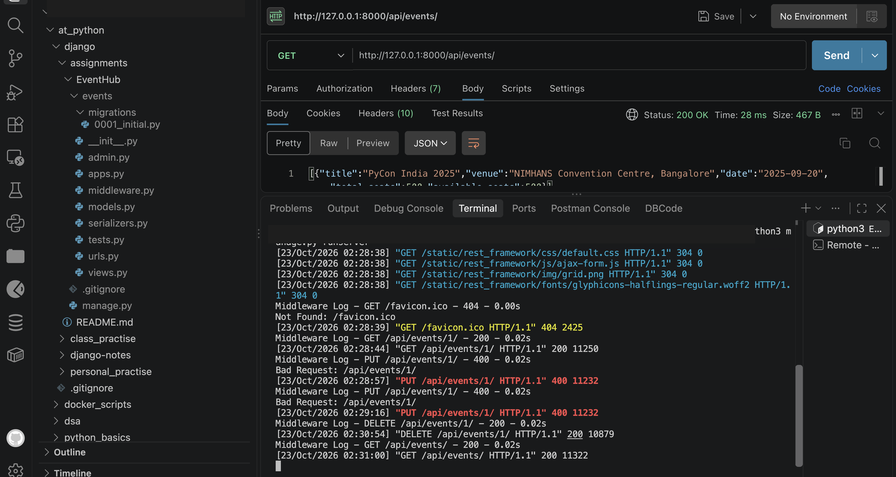

# EventHub

EventHub is a Django REST Framework API for managing technology events and
seat reservations. Events and reservations are stored in PostgreSQL.

## Features

- Create, list, retrieve, update, and delete events.
- Filter events by status and by a case-insensitive partial venue match.
- Create and list reservations, and filter reservations by event ID.
- Check event status and seat availability before booking.
- Restore reserved seats when a reservation is cancelled.
- Validate that available seats do not exceed total capacity.
- Log each HTTP request's method, path, response status, and duration.

## Design choices

- `ModelViewSet` supplies the standard event and reservation endpoints.
- `EventFilter` in `events/filters.py` uses `icontains` for venue filtering and
  `exact` for status filtering. The global `DjangoFilterBackend` is configured
  in `conf/settings.py`.
- `EventSerializer` validates seat counts and prevents updates from reducing
  either the event's total seats or its available seats.
- `ReservationSerializer` checks event eligibility and seat availability,
  then updates available seats as part of reservation creation.
- `RequestLoggingMiddleware` logs request and response details to the
  development console.

## Requirements

- Python 3.13 (or a compatible Python version supported by the installed
  Django release)
- PostgreSQL
- pip

## Run locally

Run commands from the EventHub project directory. Configure PostgreSQL to
match the `DATABASES["default"]` settings in `conf/settings.py`, or update
those settings for your local database.

```bash
cd /path/to/EventHub
python -m venv .venv
source .venv/bin/activate
python -m pip install Django djangorestframework django-filter "psycopg[binary]"
export DJANGO_SECRET_KEY="$(python -c 'from django.core.management.utils import get_random_secret_key; print(get_random_secret_key())')"
export POSTGRES_DB=postgres
export POSTGRES_USER=postgres
export POSTGRES_PASSWORD=your-local-postgres-password
export POSTGRES_HOST=localhost
export POSTGRES_PORT=5432
python manage.py migrate
python manage.py runserver
```

The default database name and user are both `postgres`; set the environment
variables above to match your local PostgreSQL configuration. Keep actual
credentials in environment variables or a local `.env` file, and do not commit
them.

## API endpoints

The API is mounted at `/api/`.

### Events

| Method | Path | Description |
| --- | --- | --- |
| `GET` | `/api/events/` | Returns the event list. |
| `GET` | `/api/events/{id}/` | Returns one event, or `404` if it does not exist. |
| `POST` | `/api/events/` | Creates an event and returns it with `201 Created`. |
| `PUT` | `/api/events/{id}/` | Replaces an event if the submitted data is valid. |
| `PATCH` | `/api/events/{id}/` | Partially updates an event if the submitted data is valid. |
| `DELETE` | `/api/events/{id}/` | Deletes an event. |
| `GET` | `/api/events/?status={status}` | Filters by an exact status: `upcoming`, `ongoing`, `completed`, or `cancelled`. |
| `GET` | `/api/events/?venue={text}` | Filters by a case-insensitive partial venue match. |

Event creation requires `title`, `venue`, `date`, `total_seats`, and
`available_seats`. Use `YYYY-MM-DD` for the date, and ensure available seats
do not exceed total seats. The model defaults a new event's status to
`upcoming`; the current `EventSerializer` does not include status in its
request or response fields.

Example requests:

```bash
curl http://127.0.0.1:8000/api/events/
curl http://127.0.0.1:8000/api/events/1/
curl "http://127.0.0.1:8000/api/events/?status=ongoing"
curl "http://127.0.0.1:8000/api/events/?venue=atlanta"
curl -X POST http://127.0.0.1:8000/api/events/ \
  -H "Content-Type: application/json" \
  -d '{"title":"Technology Summit","venue":"Austin, TX","date":"2027-05-20","total_seats":300,"available_seats":300}'
```

### Reservations

| Method | Path | Description |
| --- | --- | --- |
| `GET` | `/api/reservation/` | Returns the reservation list. |
| `GET` | `/api/reservation/{id}/` | Returns one reservation. |
| `GET` | `/api/reservation/?event_id={id}` | Filters reservations by event ID. |
| `POST` | `/api/reservation/` | Creates a reservation and returns it with `201 Created`. |
| `POST` | `/api/reservation/{id}/cancel/` | Cancels a reservation and restores its seats to the event. |

Reservations require an event ID, attendee name, attendee email, and a positive
`seats_reserved` count. Reservations can be made only for upcoming or ongoing
events, and the requested seats cannot exceed the event's current availability.
Reservation updates and deletion are not enabled.

Example requests:

```bash
curl http://127.0.0.1:8000/api/reservation/
curl "http://127.0.0.1:8000/api/reservation/?event_id=1"
curl -X POST http://127.0.0.1:8000/api/reservation/ \
  -H "Content-Type: application/json" \
  -d '{"event":1,"attendee_name":"Morgan Lee","attendee_email":"morgan@example.com","seats_reserved":2}'
curl -X POST http://127.0.0.1:8000/api/reservation/1/cancel/
```

## Screenshots

### Create an event

`POST /api/events/`



### Get events

`GET /api/events/`



### Filter events by status

`GET /api/events/?status=ongoing`



### Filter events by venue

`GET /api/events/?venue=Atlanta`



### Create a reservation

`POST /api/reservation/`



### Reject a reservation exceeding available seats



### Reject available seats exceeding total seats



### Request logging middleware


