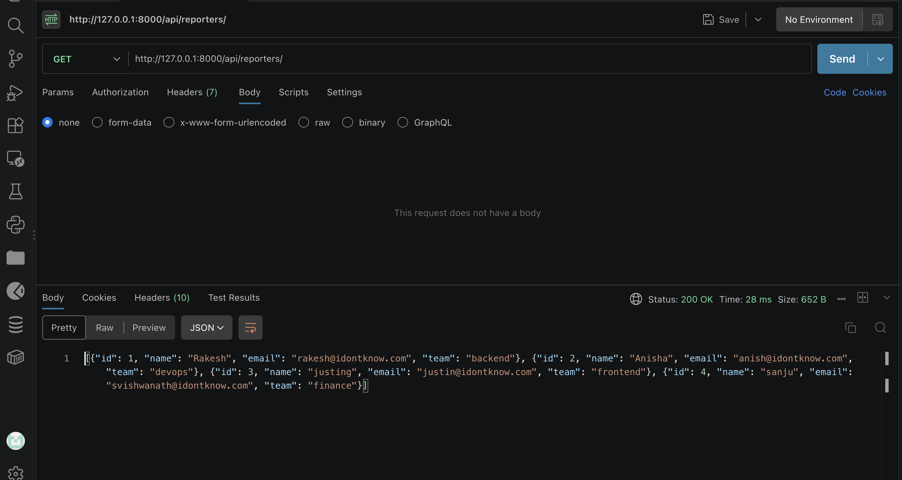
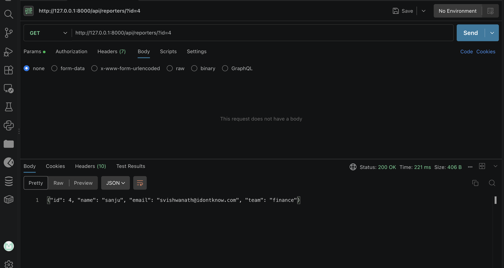
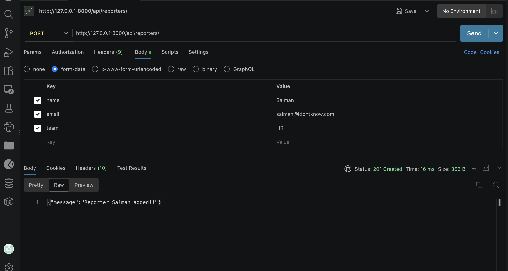
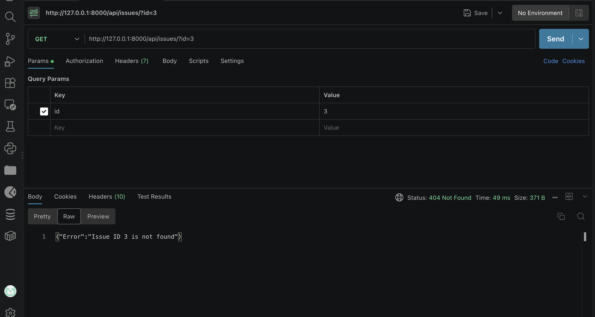
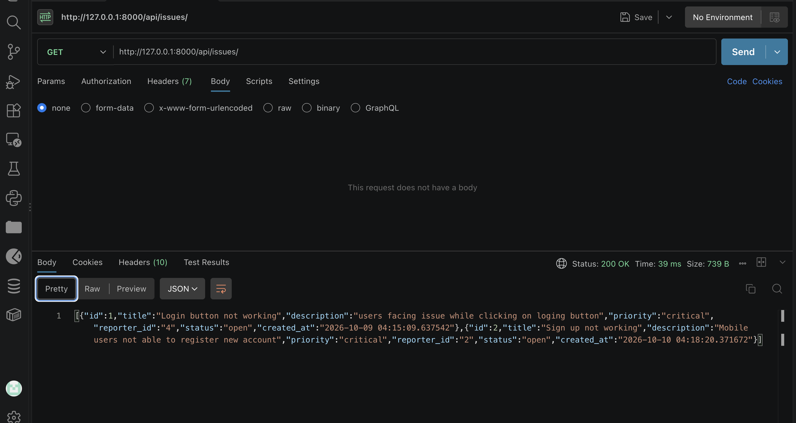
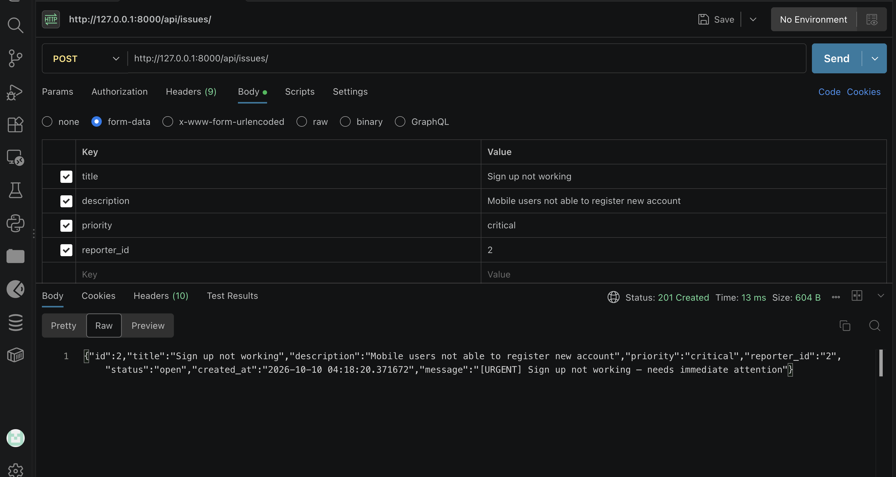

# DevTrack

DevTrack is a small Django REST Framework API for creating reporters and
tracking engineering issues. Reporter and issue records are stored in JSON
files under `issues/files/`

## Design choices

- Reporter routes use `@api_view` function views, while issue routes use
  `APIView` class views to show both styles. Class views keep each HTTP method
  in its own handler and keep each method logic independently; function views branch on the request method which keeps both the method logic tightly coupled
- `JSONFileHandler` in `issues/utils.py` centralizes JSON reads and writes,
  avoiding repeated file-handling code for reporter and issue data.

## Requirements

- Python 3.12
- pip
- All pip installed packages are defined in `requirements.txt` file

## Run locally

Run all commands from the DevTrack project directory. The JSON file paths are
relative to the current working directory, so starting the server elsewhere
will prevent the API from finding its data files.

```bash
cd /path/to/devtrack
python -m venv .venv
source .venv/bin/activate
python -m pip install Django djangorestframework
python manage.py migrate
python manage.py runserver
```

## API endpoints

### Reporters

| Method | Path | Description |
| --- | --- | --- |
| `GET` | `/api/reporters/` | Returns all reporters as a JSON array. |
| `GET` | `/api/reporters/?id={id}` | Returns the reporter with the integer ID, or `404` if it does not exist. |
| `POST` | `/api/reporters/` | Creates a reporter and returns a confirmation message with `201`. The JSON body requires `name`, `email`, and `team`; all must be non-empty and `email` must contain `@`. |

Reporter IDs are assigned by the server. Example:

```bash
curl http://127.0.0.1:8000/api/reporters/
curl "http://127.0.0.1:8000/api/reporters/?id=1"
curl -X POST http://127.0.0.1:8000/api/reporters/ \
  -H "Content-Type: application/json" \
  -d '{"name":"Morgan Lee","email":"morgan@example.com","team":"backend"}'
```

### Issues

| Method | Path | Description |
| --- | --- | --- |
| `GET` | `/api/issues/?id={id}` | Returns the issue with the integer ID, or `404` if it does not exist. |
| `GET` | `/api/issues/?status={status}` | Returns issues whose status exactly matches the supplied value. Use `open`, `in_progress`, or `closed`; if no issue matches, the response is `404`. |
| `GET` | `/api/issues/` | Returns all issues as a JSON array. |
| `POST` | `/api/issues/` | Creates an issue, assigns an ID, sets its status to `open`, and returns the created issue plus a message with `201`. The JSON body requires non-empty `title`, `description`, `priority`, and `reporter_id`. |

Issue priorities accepted when creating an issue are `low`, `medium`, `high`,
and `critical`. The `reporter_id` is required but is not checked against the
reporter list. Example:

```bash
curl "http://127.0.0.1:8000/api/issues/?id=1"
curl "http://127.0.0.1:8000/api/issues/?status=open"
curl http://127.0.0.1:8000/api/issues/
curl -X POST http://127.0.0.1:8000/api/issues/ \
  -H "Content-Type: application/json" \
  -d '{"title":"Search is unavailable","description":"Search returns an error","priority":"high","reporter_id":1}'
```

## Output

### Get all reporters

`GET /api/reporters/`



### Get a reporter by ID

`GET /api/reporters/?id=4`



### Create a reporter

`POST /api/reporters/`



### Get an issue by ID

`GET /api/issues/?id=3`



### Get issues by status

`GET /api/issues/?status={status}`

No screenshot was provided for this API call.

### Get all issues

`GET /api/issues/`



### Create an issue

`POST /api/issues/`


